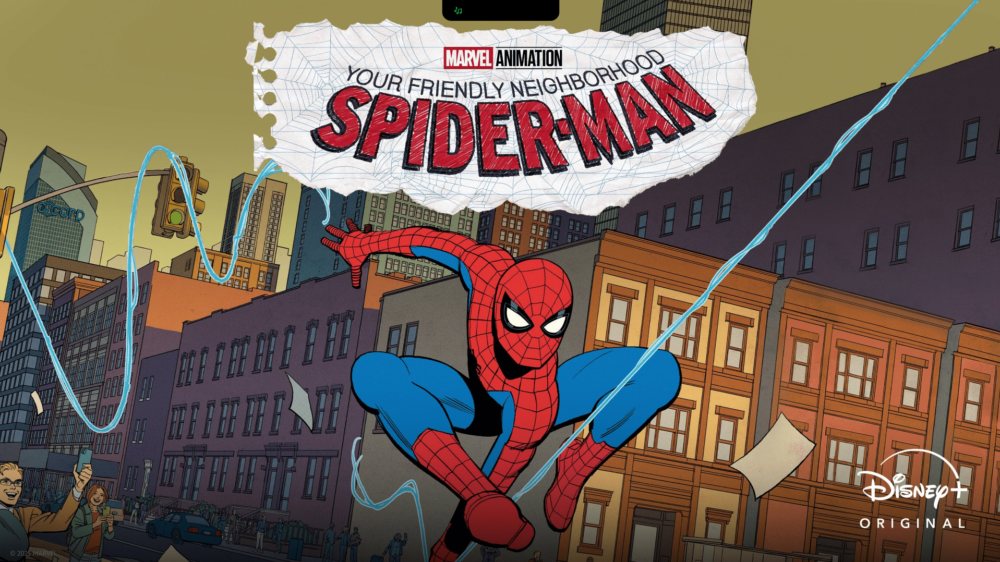
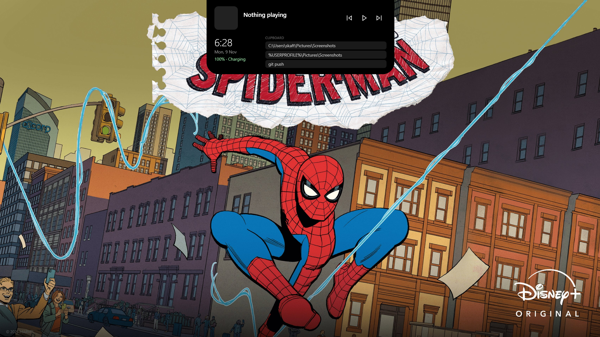

# DynamicNotch

### A macOS-inspired Dynamic Island experience for Windows.

DynamicNotch brings a sleek, interactive notch to the top of your Windows desktop. Inspired by Apple's Dynamic Island, it provides quick access to useful information and system activity through a minimal floating interface.


---

## ✨ Features

- **Dynamic Notch:** A minimal black pill positioned at the top-center of your screen.
- **Hover Interaction:** Expand and collapse the notch by moving your mouse over it.
- **Media Controls:** View media information and control playback.
- **Battery Information:** Monitor battery level and charging status.
- **Volume Controls:** Display volume and mute status.
- **Clipboard History:** Quickly access your recently copied text.
- **Quick Glance:** View the current time, date, and battery information.
- **System Activity:** Get useful popups for events such as track changes and low battery.

## 🖥️ Requirements

- Windows 10 or Windows 11 (64-bit).
- For the standalone executable, no separate .NET installation is required.
- For building from source, install the .NET 8 SDK.

## 🚀 Installation

### Option 1: Download the executable

1. Visit the [GitHub Releases](https://github.com/Pagaljanwar46/DynamicNotch/releases) page.
2. Download the latest `DynamicNotch.exe`.
3. Run the executable.

### Option 2: Build from source

Clone the repository:

```bash
git clone https://github.com/Pagaljanwar46/DynamicNotch.git
```

Open the project folder:

```bash
cd DynamicNotch
```

Restore dependencies:

```bash
dotnet restore
```

Run the application:

```bash
dotnet run
```

To create a standalone Windows executable:

```bash
dotnet publish -c Release -r win-x64 --self-contained true -p:PublishSingleFile=true -p:IncludeNativeLibrariesForSelfExtract=true
```

## 🛠️ Built With

- C#
- WPF (Windows Presentation Foundation)
- .NET 8
- Windows Runtime APIs

## 📸 Preview

### DynamicNotch in action


### Screenshots

| Collapsed View | Expanded View |
|---|---|
|  |  |

### Media Controls


## 🗺️ Roadmap

Planned improvements:

- [ ] More fluid animations and transitions.
- [ ] Improved macOS-inspired visual design.
- [ ] Customization and appearance settings.
- [ ] Windows notification integration.
- [ ] Multi-monitor support.
- [ ] Start automatically with Windows.
- [ ] System tray integration.
- [ ] Improved media artwork and playback progress.

## 🤝 Contributing

Contributions, suggestions, and bug reports are welcome.

If you find a bug or have an idea for a new feature, feel free to open an issue or submit a pull request.

## 📬 Contact

**Developer:** Aftab  
**GitHub:** [@Pagaljanwar46](https://github.com/Pagaljanwar46)

---

*DynamicNotch is an independent project inspired by the macOS Dynamic Island concept. It is not affiliated with or endorsed by Apple.*